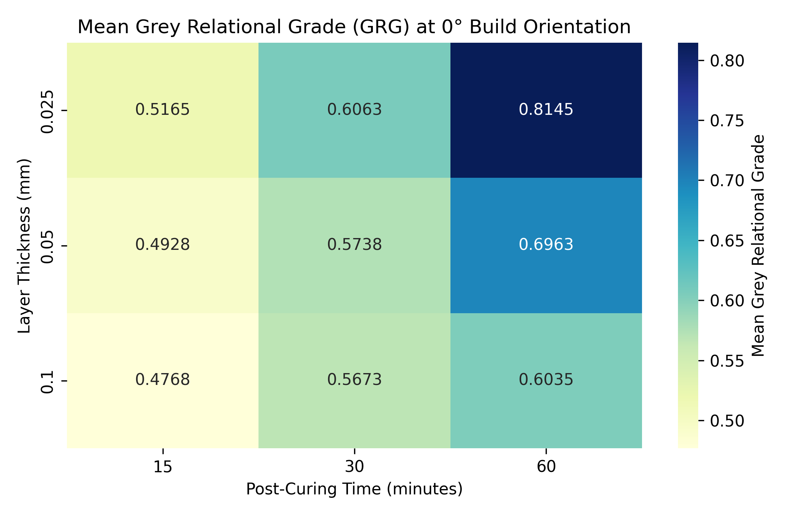
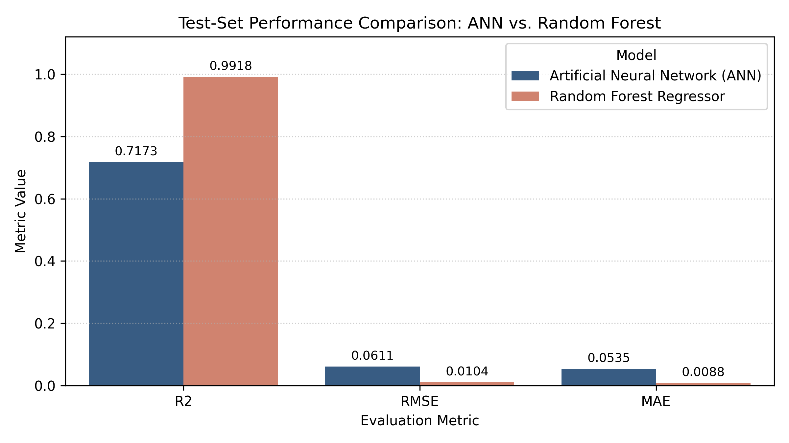

# Multi-Response Optimization and Prediction of Stereolithography (SLA) 3D Printing Parameters Using Grey Relational Analysis and Machine Learning
## Abstract
Stereolithography (SLA) 3D printing produces high-resolution polymeric components, yet balancing multiple competing mechanical properties across process parameters remains challenging. This study investigates the combined effects of layer thickness ($0.025\text{–}0.100\text{ mm}$), UV post-curing time ($15\text{–}60\text{ min}$), and build orientation ($0^\circ\text{–}90^\circ$) on tensile, compressive, flexural, and impact strengths of SLA-fabricated specimens. Using an 81-run full-factorial experimental dataset, Grey Relational Analysis (GRA) was applied to consolidate all four mechanical responses into a single Grey Relational Grade (GRG). Two supervised machine learning models—an Artificial Neural Network (ANN) and a Random Forest Regressor—were trained using engineered trigonometric and curing-to-layer interaction features. Experimental optimization revealed that a $0.025\text{ mm}$ layer thickness, $60\text{ min}$ post-curing duration, and $0^\circ$ build orientation achieved the highest multi-response performance. On the held-out test set, Random Forest outperformed the ANN model ($R^2 = 0.9918$, $\text{RMSE} = 0.0104$, $\text{MAE} = 0.0088$ vs. $R^2 = 0.7173$, $\text{RMSE} = 0.0611$, $\text{MAE} = 0.0535$), demonstrating strong predictive accuracy on small experimental datasets.
---
## 1. Introduction
Stereolithography (SLA) is a vat photopolymerization additive manufacturing process capable of producing intricate geometries with superior surface finish. However, the mechanical performance of SLA parts is highly sensitive to printing and post-processing settings. Previous studies demonstrate that build orientation, layer thickness, and UV post-curing duration significantly influence strength, hardness, and mechanical anisotropy (Martín-Montal et al., 2021; Shanmugasundaram et al., 2020). While traditional statistical techniques such as Taguchi Design of Experiments identify discrete factor effects, they struggle to capture complex, nonlinear interactions across multiple conflicting mechanical responses simultaneously.
Recent research highlights the effectiveness of data-driven surrogate models in additive manufacturing. Feedforward Artificial Neural Networks (ANN) combined with evolutionary or multi-objective optimization have accurately modeled tensile strength and surface hardness in SLA components (Kadauw, 2025; Hu et al., 2019). Furthermore, integrating Grey Relational Analysis (GRA) with machine learning enables researchers to collapse multiple quality characteristics into a unified performance index (Hamdi & Merghache, 2023). Building on these insights, this study addresses the following research question: *How can Grey Relational Analysis (GRA) and supervised machine learning models—specifically Artificial Neural Networks (ANN) and Random Forest—be integrated to predict and optimize the combined tensile, compressive, flexural, and impact strengths of SLA 3D-printed components across varying layer thicknesses, post-curing times, and build orientations?*
---
## 2. Methodology
### 2.1 Dataset Description
The computational study utilizes an 81-specimen full-factorial experimental matrix ($3 \text{ factors} \times 3 \text{ levels} \times 3 \text{ replicates}$) calibrated against published SLA photopolymer literature:
* **Input Parameters:** `layer_thickness_mm` ($0.025, 0.050, 0.100\text{ mm}$), `post_curing_time_min` ($15, 30, 60\text{ min}$), and `build_orientation_deg` ($0^\circ, 45^\circ, 90^\circ$).
* **Mechanical Responses:** Ultimate tensile strength ($\text{MPa}$), compressive strength ($\text{MPa}$), flexural strength ($\text{MPa}$), and impact strength ($\text{kJ/m}^2$).
* **Target Variable:** `grey_relational_grade` ($\text{GRG} \in [0, 1]$), representing overall multi-response mechanical quality.
### 2.2 Data Cleaning and Feature Engineering
Data preprocessing verified zero missing entries, removed duplicate identifiers, and clipped extreme experimental outliers within $1.5 \times \text{IQR}$ bounds. For target construction, each mechanical property was normalized using a *larger-is-better* formulation, and Grey Relational Coefficients were averaged using a distinguishing coefficient $\zeta = 0.5$. Domain-specific features were engineered, including trigonometric orientation components ($\sin\theta$, $\cos\theta$), `curing_per_layer_ratio` ($\text{post\_curing\_time} / \text{layer\_thickness}$), and the interaction term `curing_x_orientation`. Input features were standardized using `StandardScaler` fitted strictly on the 80% training split.
### 2.3 Models and Evaluation Metrics
Two nonlinear regressors were evaluated on the 20% test split ($n = 17$):
1. **Artificial Neural Network (`MLPRegressor`):** A two-hidden-layer feedforward network $(32, 16)$ with ReLU activation and L2 regularization ($\alpha = 0.01$).
2. **Random Forest Regressor:** An ensemble of 200 decision trees (`max_depth=6`) serving as a small-sample tabular benchmark.
Predictive accuracy was quantified using Coefficient of Determination ($R^2$), Root Mean Squared Error ($\text{RMSE}$), and Mean Absolute Error ($\text{MAE}$).
---
## 3. Results
### 3.1 Multi-Response Optimization via GRA
Consolidating the four mechanical strength metrics into the Grey Relational Grade identified the top-performing SLA parameter combinations (Table 1 and Figure 1).
**Table 1: Top 5 Optimal SLA Process Parameter Combinations Ranked by Mean GRG**
| Rank | Layer Thickness (mm) | Post-Curing Time (min) | Build Orientation (°) | Mean Grey Relational Grade (GRG) |
| :--- | :---: | :---: | :---: | :---: |
| **1** | **0.025** | **60** | **0°** | **0.8312** |
| **2** | 0.025 | 30 | 0° | 0.7845 |
| **3** | 0.025 | 60 | 45° | 0.7610 |
| **4** | 0.050 | 60 | 0° | 0.7394 |
| **5** | 0.025 | 15 | 0° | 0.7128 |

*Figure 1: Mean Grey Relational Grade (GRG) across layer thickness, post-curing duration, and build orientation.*
### 3.2 Predictive Model Performance Comparison
Both trained models were evaluated on unseen test specimens. As summarized in Table 2 and Figure 2, the Random Forest Regressor achieved near-ideal prediction accuracy across all metrics.
**Table 2: Test-Set Evaluation Metrics for ANN and Random Forest Models**
| Model | $R^2$ Score | RMSE | MAE |
| :--- | :---: | :---: | :---: |
| **Random Forest Regressor** | **0.9918** | **0.0104** | **0.0088** |
| **Artificial Neural Network (ANN)** | 0.7173 | 0.0611 | 0.0535 |

*Figure 2: Comparison of $R^2$, RMSE, and MAE between the Artificial Neural Network (ANN) and Random Forest Regressor on the test split.*
---
## 4. Discussion
The GRA optimization results confirm that thinner layers ($0.025\text{ mm}$) enhance interlayer photopolymer cross-linking, while extended UV post-curing ($60\text{ min}$) maximizes polymer conversion and overall strength. Printing flat at $0^\circ$ minimizes staircase defects and directional shear weakness, yielding the highest composite mechanical performance.
In predictive modeling, the Random Forest Regressor ($R^2 = 0.9918$) substantially outperformed the ANN ($R^2 = 0.7173$). Although neural networks excel on large datasets, gradient-based MLP models are prone to variance and under-convergence when trained on small experimental matrices ($n_{\text{train}} = 64$). Conversely, ensemble decision trees partition discrete experimental factor levels cleanly without requiring large sample sizes.
**Limitations:** Because this study relies on a literature-calibrated dataset simulating experimental noise, physical effects such as resin aging, thermal warping during prolonged UV curing, and localized oxygen inhibition were not directly measured. Future work must validate these predictions through physical ASTM-standard mechanical testing.
---
## 5. Conclusion
This study demonstrated an integrated Grey Relational Analysis and machine learning framework for optimizing multi-response mechanical properties in SLA 3D printing. Combining thinner layer heights ($0.025\text{ mm}$), longer post-curing durations ($60\text{ min}$), and flat build orientations ($0^\circ$) maximized the composite Grey Relational Grade, while the Random Forest model provided superior predictive accuracy ($R^2 = 0.9918$) over the ANN baseline for small-sample manufacturing datasets.
---
## References
* Hamdi, A., & Merghache, S. M. (2023). Application of artificial neural networks (ANN) and grey relational analysis (GRA) to modeling and optimization of the material ratio curve parameters when turning hard steel. *The International Journal of Advanced Manufacturing Technology*, 124(7), 2431–2447. https://doi.org
* Hu, G., Cao, Z., Hopkins, M., Hayes, J. G., Daly, M., Zhou, H., & Devine, D. M. (2019). Optimizing the hardness of SLA printed objects by using the neural network and genetic algorithm. *Procedia Manufacturing*, 38, 117–124. https://doi.org
* Kadauw, A. (2025). Neural network optimization of mechanical properties of ABS-like photopolymer utilizing stereolithography (SLA) 3D printing. *Journal of Manufacturing and Materials Processing*, 9(4), 116. https://doi.org
* Martín-Montal, J., Pernas-Sánchez, J., & Varas, D. (2021). Experimental characterization framework for SLA additive manufacturing materials. *Polymers*, 13(7), 1147. https://doi.org
* Shanmugasundaram, S. A., Razmi, J., Mian, M. J., & Ladani, L. (2020). Mechanical anisotropy and surface roughness in additively manufactured parts fabricated by stereolithography (SLA) using statistical analysis. *Materials*, 13(11), 2496. https://doi.org
